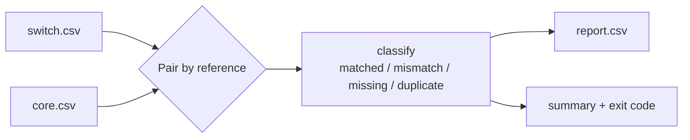

# switch-reconciliation-tool

Batch reconciliation for a card/transfer switch against the core banking journal. Operations teams
run it at end of day: it pairs entries by reference, classifies every break, writes a CSV for the
settlement team, and fails the pipeline when open breaks remain.

The problem it solves is the one I handled in production: two systems report the same transactions,
and the differences must be found before money moves.

## Rules

| Case | Status |
|---|---|
| Same reference, same amount, same currency | `Matched` |
| Same reference, different currency | `CurrencyMismatch` |
| Same reference, different amount | `AmountMismatch` (note carries the delta) |
| Reference only in switch file | `MissingInCore` |
| Reference only in core file | `MissingInSwitch` |
| Reference repeated in switch file | `DuplicateInSwitch` (amounts summed) |
| Reference repeated in core file | `DuplicateInCore` (amounts summed) |

Duplicates are evaluated before amount checks, because a repeated reference already makes the
group unreconcilable.

## Flow



## Run

```bash
dotnet run --project src/Reconciliation -- \
  --switch samples/switch.csv \
  --core samples/core.csv \
  --out samples/report.csv
```

Input format (header required):

```csv
reference,amount,currency,valueDate
SW-1001,150000.00,IDR,2026-11-17
```

Output on the sample data:

```text
records      : 6
matched      : 1
breaks       : 5
switch total : 1050099.50
core total   : 595099.50
difference   : 455000.00
```

`report.csv`:

```csv
reference,status,switchAmount,coreAmount,note
SW-1001,Matched,150000.00,150000.00,
SW-1002,AmountMismatch,250000.00,245000.00,delta 5000.00
SW-1003,CurrencyMismatch,99.50,99.50,USD vs SGD
SW-1004,MissingInCore,400000.00,,"Debited by switch, absent in core journal"
SW-1005,MissingInSwitch,,75000.00,"Posted in core, absent in switch file"
SW-1006,DuplicateInSwitch,250000.00,125000.00,2 rows in switch file
```

## Exit codes

| Code | Meaning |
|---|---|
| 0 | Every reference matched |
| 2 | Breaks found (report still written) |
| 1 | Input error: missing file, bad header, invalid amount/date |

Exit code 2 lets a scheduler halt settlement while still keeping the report.

## Test

```bash
dotnet test
```

14 tests: every classification rule, ordering, break counting, totals and difference, CSV header and
field validation, and report escaping/formatting.

## Design notes

- Money is `decimal` and every output is formatted with `InvariantCulture`, so an operator laptop
  with a comma decimal separator cannot produce a different report than CI.
- The engine is pure (lists in, result out), which keeps the matching rules directly testable
  without files or a database.
- Header validation fails fast; a silent column shift is worse than a stopped batch.

## Limitations (deliberate)

- CSV parsing assumes no quoted commas in the input. Real exports should be read with a proper CSV
  library.
- Single-currency totals: the summary sums nominal amounts, suitable when one batch runs per currency.
  Multi-currency batches need totals grouped by currency.
